

# گزارش پیاده‌سازی Neon Tunnel Runner

**علیرضا پویان — Alireza Pooyan — 400414039**

Computer Game Design — HW2 · تحویل نهایی Task 16 · آبان ۱۴۰۵

## ۱. مشخصات پروژه و دانشجو

این پروژه یک بازی رانندگی بی‌پایان سه‌بعدی با سه خط حرکت و دوربین سوم‌شخص است. نام بازی و فایل اجرایی به‌ترتیب `Neon Tunnel Runner` و `NeonTunnelRunner.exe` است. دانشجو: **علیرضا پویان — Alireza Pooyan — 400414039**؛ درس: **Computer Game Design — HW2**.

منبع آزموده‌شده، commit محلی `e97572a` است. نسخهٔ کامل آن `e97572aba25d8bcff7e336c4bf6ef8b6e3c540fc` است و در `delivery/repository-link.txt` نیز ثبت شده است. نشانی عمومی مخزن https://github.com/AZAX16/NeonTunnelRider.git بررسی و قابل دسترسی بود، اما مخزن در زمان بررسی خالی است؛ انتشار commit و دسترسی مدرس به منبع **PENDING** است. clone محلی، اثبات دسترسی اینترنتی مدرس نیست.

نسخه‌ها بدون ارتقا حفظ شده‌اند: `Unity 6000.6.3f1`، `URP 17.6.0`، `Input System 1.20.0`، `Test Framework 1.8.0` و ابزار Editor با نام `Unity Pipeline 0.9.1-exp.1`. محیط آماده‌سازی Linux Mint است؛ هدف تحویل الزاماً **Windows x86_64 / StandaloneWindows64** با backend موجود `Mono` است. گزارش نهایی build و هش فایل‌ها در `Evidence/Task16/` نگهداری می‌شود.

## ۲. معرفی بازی و کنترل‌ها

ماشین به‌صورت خودکار رو به جلو حرکت می‌کند. هدف، افزایش مسافت و جمع‌آوری سکه برای ثبت بهترین امتیاز است؛ پایان برد مشخصی وجود ندارد. سرعت از ۲۲ تا ۵۰ متر بر ثانیه افزایش می‌یابد و تراکم ترافیک نیز با دشواری بیشتر می‌شود. سه خط در مختصات عرضی ۳٫۲−، صفر و ۳٫۲ متر قرار دارند.

- `A` یا پیکان چپ: یک خط به چپ؛ `D` یا پیکان راست: یک خط به راست. نگه‌داشتن کلید، فرمان تکراری ایجاد نمی‌کند.
- `Escape`: توقف و ادامهٔ بازی. منوها با ماوس یا کلیدهای جهت و `Enter` اداره می‌شوند؛ کلیدهای دقیق در `Runner.inputactions` تعریف شده‌اند.
- منوی آغاز دارای `Start` و `Quit` است. منوی توقف، `Resume`، `Restart` و `Main Menu` دارد. صفحهٔ پایان، امتیاز، بهترین امتیاز و `Restart` را نمایش می‌دهد. برای خروج، ابتدا از منوی توقف به منوی اصلی بروید و `Quit` را انتخاب کنید.

بازی با سه جان و ۱۰۰ واحد سوخت شروع می‌شود. برخورد معتبر یک جان کم می‌کند؛ مهلت محافظت از آسیب تکراری جلوگیری می‌کند. سوخت در زمان شبیه‌سازی کم می‌شود و گالن ۳۰ واحد، تا سقف ظرفیت، اضافه می‌کند. هر سکه ۱۰۰ امتیاز دارد؛ امتیاز برابر جزء صحیح مسافت به‌علاوهٔ امتیاز سکه‌هاست. **صفر شدن جان یا تمام شدن سوخت، هر دو Game Over هستند**؛ در هم‌زمانی، دلیل جان اولویت دارد. بهترین امتیاز با `PlayerPrefs` ذخیره می‌شود. رکورد کسب‌شدهٔ **۲۷٬۳۱۶** در محیط اصلی حفظ شده است.

## ۳. ساختار پیاده‌سازی و معماری

صحنهٔ واحد و ذخیره‌شدهٔ `Assets/NeonTunnelRunner/Scenes/Game.unity` نقطهٔ ورود build است. ریشه‌های اصلی آن شامل `Systems`، `Player`، `World`، `Pools`، `Presentation`، `Audio`، `UI` و `EventSystem` هستند. وابستگی‌ها از طریق فیلدهای serialized صحنه و prefab متصل‌اند؛ برای تحویل، صحنه یا prefab تازه‌ای جایگزین نشده است.

`GameManager` تنها singleton است و حالت‌های `Menu`، `Playing`، `Paused` و `GameOver` و تراکنش آغاز، توقف، ادامه و بازنشانی را اداره می‌کند. `RunSession` مدل مالک مقادیر هر اجراست؛ جان، سوخت، زمان، مسافت، سکه، امتیاز و بهترین امتیاز از آن خوانده می‌شوند. رویدادهای نوع‌دار، داده را به نمایشگرها می‌رسانند و نمایشگرها مالک قواعد بازی نیستند.

`GameplayLoop` ترتیب ثابت پیش‌بینی حرکت، تشخیص تماس، پاداش و آسیب، ثبت وضعیت، مصرف سوخت، تعیین پایان، تولید جهان و انتقال مبدأ را اجرا می‌کند. `PlayerController` مالک وضعیت حرکت بین خطوط است. `InteractionSensor` با محاسبهٔ swept bounds نسبی، مسیر طی‌شدهٔ بازیکن و هدف را بررسی می‌کند تا تماس سریع از دست نرود. شناسهٔ فعال‌سازی هر شیء pool مانع تکرار پاداش یا آسیب پس از استفادهٔ مجدد می‌شود.

<pre dir="ltr">GameManager → RunSession + GameplayLoop
GameplayLoop → Player / Survival / InteractionSensor
             → RoadManager / SpawnDirector / WorldOrigin
             → ProgressionSystem / PoolService
RunSession events → HUD / Audio / Camera / VFX
GameManager → NearMissSequence → shared clock + camera + music</pre>

## ۴. سیستم‌های اصلی و ارتباط آن‌ها

کلاس انتزاعی `Interactable` قرارداد تماس و چرخهٔ استفاده از pool را تعریف می‌کند. چهار پیاده‌سازی `StationaryCar`، `MovingCar`، `Coin` و `FuelCan` رفتار مربوط به مانع ثابت، ترافیک متحرک، سکه و سوخت را با override مشخص می‌کنند. بازیکن، برخورد و پاداش مسیر موازی جداگانه‌ای ندارند.

`PoolService` نمونه‌های محدود و از پیش آماده‌شده را برای جاده، خودرو، آیتم و جلوه‌ها نگه می‌دارد. `RoadManager` قطعات ۶۰ متری را جلو می‌چیند و پشت سر بازیافت می‌کند. `WorldOrigin` مبدأ محلی و تاریخچهٔ حرکت را هماهنگ جابه‌جا می‌کند تا مسافت کل مستقل از مختصات محلی بماند. `SpawnDirector` و `PatternValidator` با seed، مسیر محافظت‌شده، حاشیهٔ تغییر خط، پیش‌بینی حرکت و مسیر سوخت، پیشنهادهای ناامن را حذف می‌کنند؛ هر پیشنهاد الزاماً به خودروی پذیرفته‌شده تبدیل نمی‌شود.

تمام ورودی‌ها از New Input System و Action Mapهای `Gameplay`، `System` و `UI` می‌گذرند؛ `InputSystemUIInputModule` ورودی منو را دریافت می‌کند. `ProgressionSystem` دشواری و امتیاز را محاسبه می‌کند و `HighScoreStore` مرز ذخیره‌سازی است. هنگام Pause، شبیه‌سازی و فرمان‌های حرکت متوقف می‌شوند و منو پاسخ‌گو می‌ماند؛ بازنشانی، منابع، poolها، دوربین، جلوه‌ها و صداها را با ترتیب مشخص پاک‌سازی می‌کند.

`HudPresenter` جان، سوخت، سرعت بر حسب کیلومتر بر ساعت، امتیاز و رکورد را نمایش می‌دهد. `MenuPresenter` پنل‌ها و فوکوس را مدیریت می‌کند. `AudioController` موسیقی، موتور و هشت صدای کوتاه قابل استفادهٔ مجدد را کنترل می‌کند؛ منبع موسیقی نزدیک‌گذر نیز مستقل است. `VehicleVisuals` چراغ جلو، نور زیر بدنه و اگزوز را با سرعت واقعی هماهنگ می‌کند. `VfxController` و `FireworkDirector` جرقه، جمع‌آوری و آتش‌بازی را از pool اجرا می‌کنند. `ChaseCamera` دوربین تعقیبی، بازخورد برخورد و تغییر نرم FOV را ارائه می‌دهد. محیط شب، skybox ستاره‌ای، تونل، Bloom و نورهای نئونی در URP پیاده شده‌اند.

## ۵. قابلیت‌های اضافه‌شده در Task 15B

- زمان تغییر خط مجاور از ۰٫۲۸ به **۰٫۱۲ ثانیهٔ شبیه‌سازی** رسیده؛ مدت حرکت حدود **۵۷٫۱٪** کمتر شده است.
- پیشنهاد ترافیک جلو و سهم ماشین متحرک بیشتر شده است. افزایش ثبت‌شدهٔ خودروهای پذیرفته‌شده در نمونه‌های شروع، میانه و سقف دشواری **۲۳٫۹٪، ۲۱٫۴٪ و ۱۸٫۹٪** است؛ افزایش اندازه‌گیری‌شدهٔ ۳۰٪ ادعا نمی‌شود.
- ماشین‌های معمولی پشت مانع ثابت یا خودروی کندتر سرعت کم می‌کنند. خودروهای سریع‌تر از پشت با سرعت پیشروی بازیکن به‌علاوهٔ حاشیهٔ seedشدهٔ **۶ تا ۱۲ متر بر ثانیه** نزدیک می‌شوند. ورود و خروج آن‌ها و تغییر خط مجاور، وابسته به پیش‌بینی ایمنی و رزرو مسیر است؛ همان pool محدود خودروها استفاده می‌شود.
- هشدار زرد `LEFT`، `CENTRE` یا `RIGHT` پیش از ورود پیشنهادی از پشت، حدود **۱٫۵ ثانیهٔ واقعی در حالت Playing** نمایش داده می‌شود. پس از هشدار، پیشنهاد دوباره اعتبارسنجی می‌شود و ممکن است به‌علت ناامنی حذف شود.
- نزدیک‌گذر فقط با **۲٫۵ ثانیه ماندن پیوسته پشت همان خودرو و در همان خط** آغاز معتبر دارد؛ سپس یک ثانیه برای عبور تمیز از خط مجاور وجود دارد. فقط عبور موفق، ۲٫۵ ثانیهٔ پایانی را به دست می‌آورد. شروع از کنار، خروج زودهنگام، تماس، گم‌شدن فعال‌سازی یا پایان اجرا، توالی را لغو می‌کند. سبقت خودرو از پشت این جلوه را فعال نمی‌کند و امتیاز اضافه‌ای ندارد.
- `NearMissSequence` وضعیت برخورد و زمان واقعی Playing را نگه می‌دارد؛ `GameManager` ساعت مشترک شبیه‌سازی و لغو را ترکیب می‌کند. زمان واقعی Playing با زمان شبیه‌سازی یکسان نیست؛ Pause و تعلیق فوکوس، توالی ویژه را حفظ می‌کنند.
- دوربین به‌نرمی از FOV پایهٔ **۶۵** به سمت **۵۸ درجه** می‌رود و بازمی‌گردد. گزیدهٔ شش‌ثانیه‌ای موسیقی با pitch برابر ۱ و crossfade اجرا می‌شود؛ موسیقی عادی در زیر آن ادامه دارد و از ابتدا آغاز نمی‌شود. مکث و تعلیق فوکوس، موقعیت پخش را حفظ می‌کنند.

توسعهٔ ابزار ممیزی ارجاع‌های native، replay و profiling، کاهش تخصیص‌های HUD و اصلاح ظاهر دکمه‌ها، ابزار و بهبود پشتیبان‌اند و از قابلیت‌های گیم‌پلی تفکیک می‌شوند. در نمونهٔ تاریخی سقف دشواری، **تغییر خط پذیرفته‌شدهٔ NPC مشاهده نشد**؛ وجود کد، اثبات مشاهده در همهٔ شرایط نیست. singleton تازه یا جایگزینی برای New Input System اضافه نشده است.

## ۶. تصاویر واقعی از اجرای نهایی

تصاویر زیر مستقیماً از **Unity Editor Play Mode روی Linux**، با منبع گیم‌پلی commit محلی `e97572a` گرفته شده‌اند؛ تصویر Windows standalone نیستند. هیچ تصویر تولیدشده، ترکیب‌شده یا طرح مفهومی به‌عنوان شاهد استفاده نشده است. برای رخدادهای کوتاه، fixture از اجارهٔ واقعی اشیای pool یا پیش‌روی قطعی شبیه‌سازی استفاده می‌کند؛ این روش در فهرست تصاویر ثبت شده و اثبات اجرای انسانی یا Windows نیست.

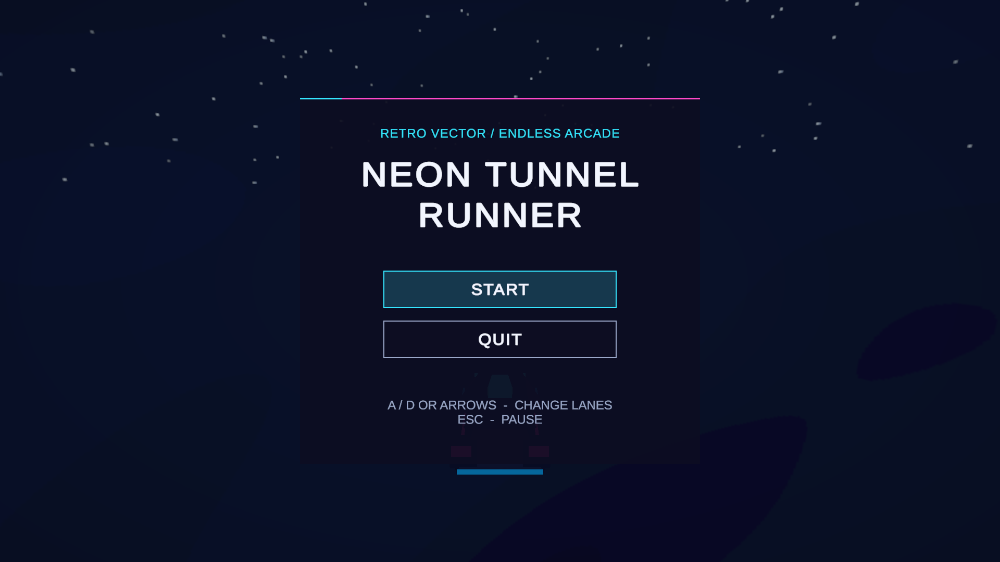

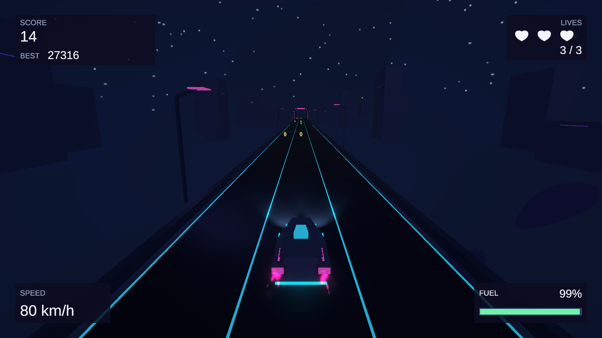

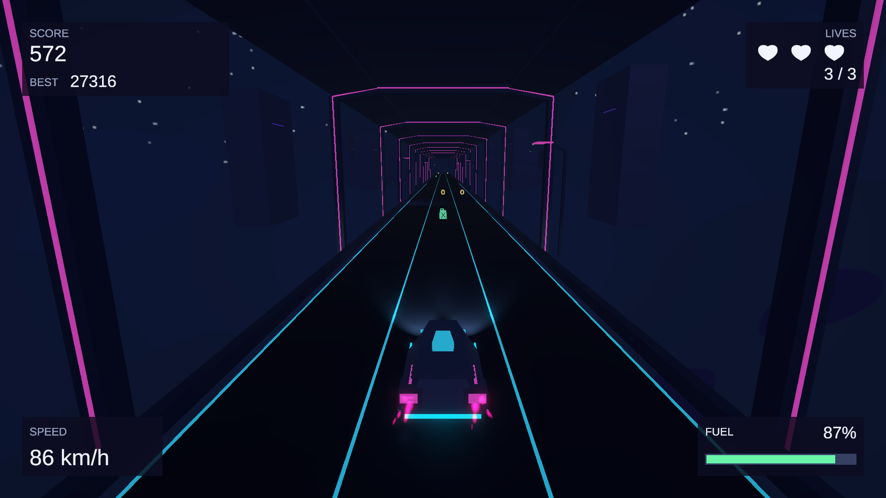

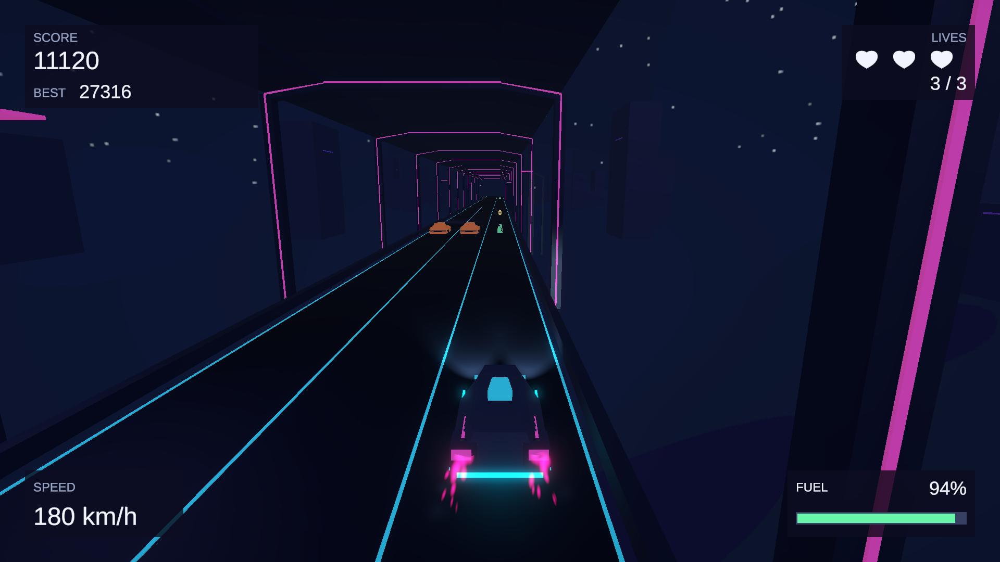

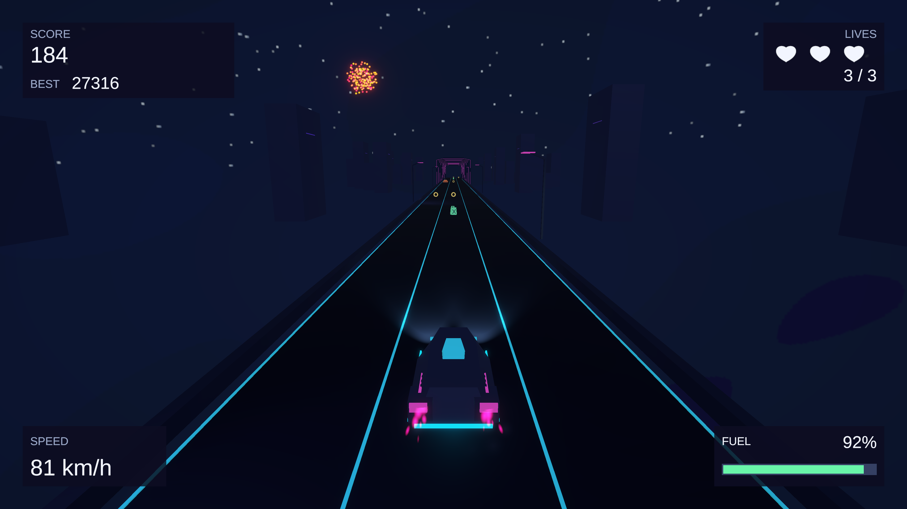

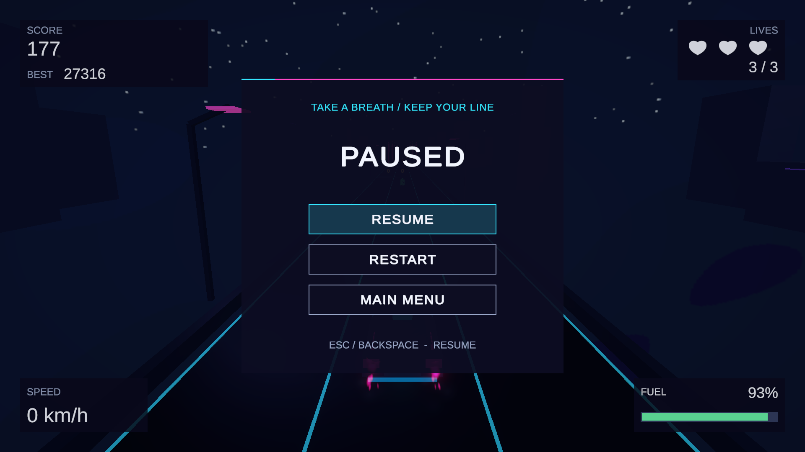

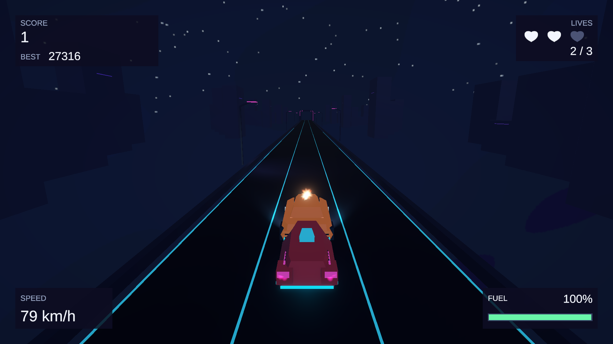

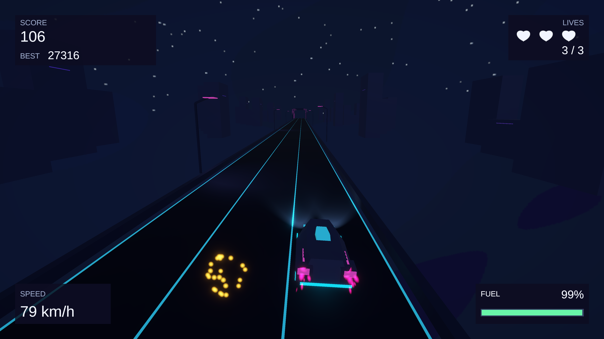

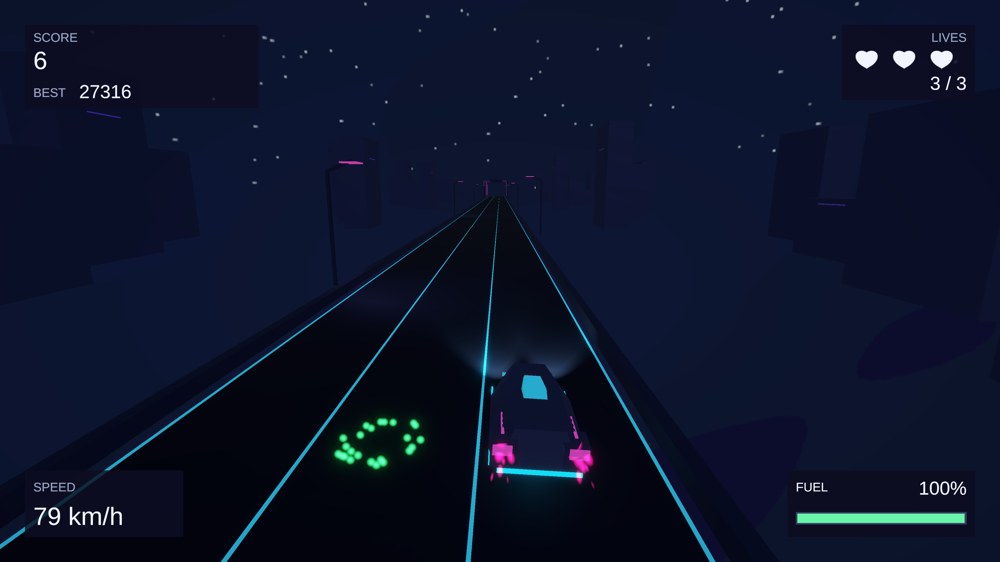

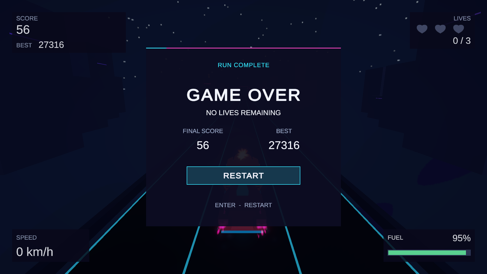

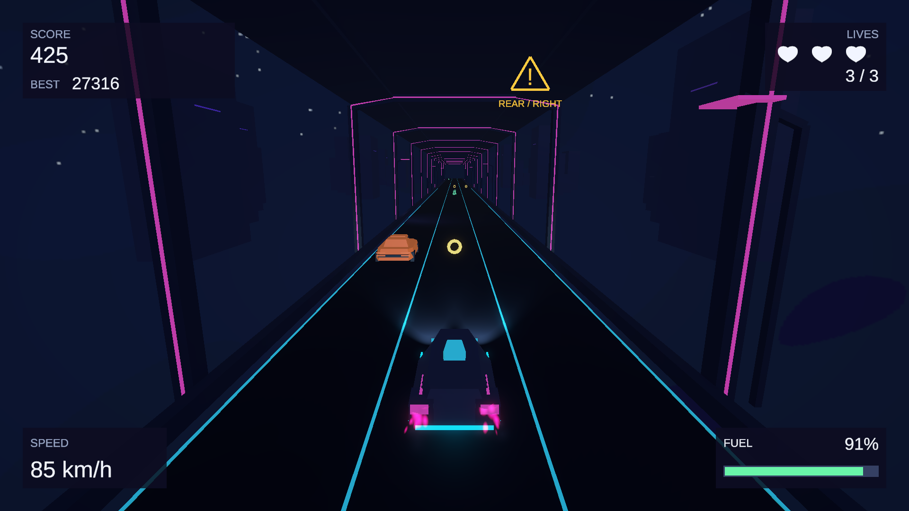

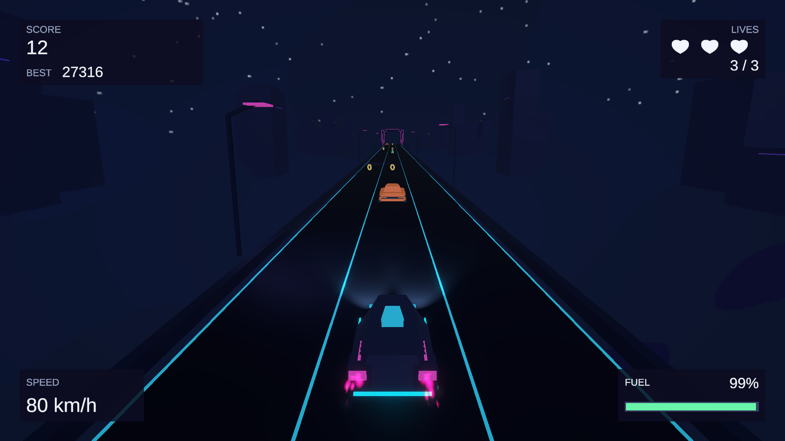

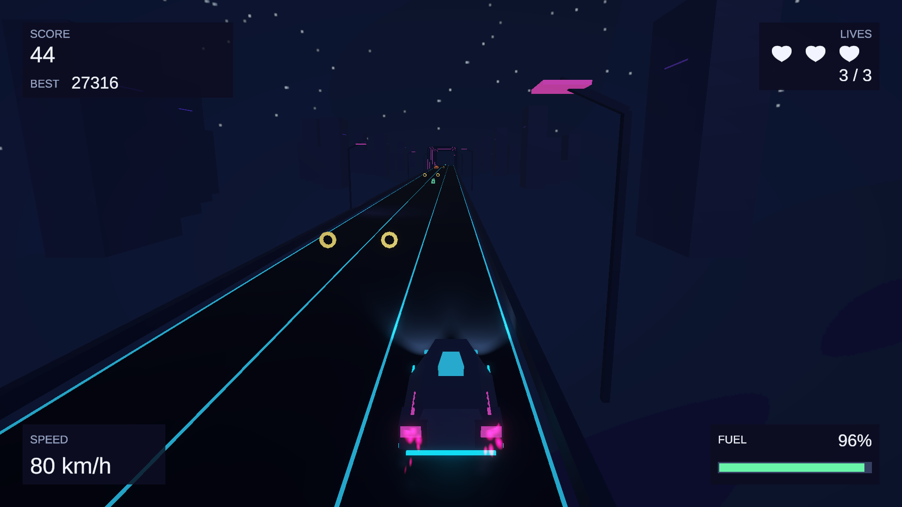

به‌دلیل کوتاه بودن پنجرهٔ عبور، readback تصویر در میانهٔ آن انجام نمی‌شود؛ trace پیوسته، حرکت و تکمیل عبور را ثبت می‌کند. تصویر ثابت به‌تنهایی زمان‌بندی یا شنیداری بودن موسیقی را اثبات نمی‌کند. فهرست کامل فایل‌ها، روش هر capture و هش آن‌ها در `delivery/Screenshots/capture-manifest.json` آمده است.

## ۷. آزمون‌ها و نتایج راستی‌آزمایی

در اجرای تازهٔ Task 16، **۱۶۱ آزمون EditMode و ۲۵۰ آزمون PlayMode، جمعاً ۴۱۱ آزمون، PASS** شدند؛ شکست، skip و inconclusive همگی صفرند. XML اصلی Test Runner و نتیجهٔ هر مورد در `Evidence/Task16/Runs/20261107T225046+0330-tests/` نگهداری شده است. موارد شامل ورودی و منو، چرخهٔ حالت‌ها، تماس سریع، مصرف و دریافت سوخت، هر دو پایان، بازنشانی، pool، جاده، ترافیک، نزدیک‌گذر، دوربین و صدا هستند. نخستین تلاش پیش از پایان کامپایل builder مسدود شد؛ نتیجهٔ آن به‌عنوان آزمون موفق گزارش نشده است.

ممیزی تازهٔ native در `Evidence/Task15Recovery/Native/20261108T0232448018500Z/`، **۲۹۴ از ۲۹۴ ارجاع PASS** و صفر مورد نامعتبر یا تأییدنشده داشت. اسکن GUID نیز در کل درخت، فایل‌های tracked، گراف تولید و recovery، صفر GUID مفقود گزارش کرد. برابری بایت‌های `.gitignore` با فایل supplied بررسی می‌شود.

نتایج **تاریخی Task 15B** جدا هستند: ۴۱۱ آزمون موفق، fairness برای ۱۰۰۰ seed در سه زمینهٔ دشواری و ۱۰ کیلومتر، آزمون‌های چهار viewport، و Development build لینوکس با صفر خطا و هشدار. build تاریخی، build نهایی Windows نیست. جزئیات و دامنهٔ دقیق در `Docs/Verification/15b-traffic-and-near-miss.md` و `15b-behind-gate.md` آمده است.

ساخت تازهٔ Windows با backend ثبت‌شدهٔ `Mono2x` موفق شد: **صفر خطا، یک هشدار، ۱۱۹٬۹۵۴٬۲۰۳ بایت طبق BuildReport** و ۱۹۶ فایل خروجی. همهٔ گزینه‌های Development، اتصال Profiler، deep profiling و script debugging خاموش‌اند. هشدار مربوط به نسخهٔ قدیمی metadata واردکنندهٔ فونت Liberation Sans است؛ منبع و GUID فونت تغییر نکرده‌اند. clone مستقل commit دقیق، با Library خالی آغاز شد؛ import و اعتبارسنجی صحنه با exit code صفر پایان یافت و هیچ فایل Assets/Packages/ProjectSettings تغییر نکرد. این آزمون clone محلی است. جزئیات در `Evidence/Task16/fresh-import-summary.json` و `Build-20261108T0232525993600Z/build-metadata.json` است. کنترل تصاویر و PDF، CRC، استخراج و هش آرشیو در `Docs/Verification/16-delivery.md` ثبت می‌شوند. موفقیت ساخت یا CRC به‌تنهایی اثبات قابل‌بازی بودن خروجی نیست. **پذیرش اجرایی Windows و Quit واقعی BLOCKED است**؛ دانشجو اعلام کرده ماشین/VM ویندوز در دسترس نیست.

## ۸. محدودیت‌ها و موارد تکمیل‌نشده

پذیرش عملکردی کامل Windows، اجرای فایل استخراج‌شده، خروج واقعی و پایداری رکورد بین دو اجرای جداگانهٔ Windows انجام نشده‌اند. نتیجهٔ Editor جای آن‌ها نیست. سنجش کامل ده‌دقیقه‌ای CPU/GPU/زمان فریم/حافظه، گواهی zero-GC کل بازی، soak دیداری سی‌دقیقه‌ای، بررسی نهایی همهٔ قواعد سخت در تمام viewportها و مقایسهٔ جفت‌شدهٔ Bloom روشن/خاموش همچنان تأیید نشده‌اند. soak متوقف‌شده به خواست دانشجو دوباره آغاز نشده است.

تصاویر برخورد و pickup با staging کنترل‌شده تهیه می‌شوند؛ آن‌ها جای پوشش کامل دیداری تمام وضعیت‌ها را نمی‌گیرند. تأیید انسانیِ شنیدن تمام بازی با آخرین مرحله‌بندی موسیقی ثبت نشده است. منبع دانلود و اجازهٔ بازتوزیع گزیدهٔ موسیقی همچنان حل‌نشده است. دسترسی اینترنتی به commit، بارگذاری در سامانه و دریافت مجدد تا انجام واقعی، **PENDING** می‌مانند.

## ۹. منابع، همکاران و استفاده از هوش مصنوعی

دانشجو و صاحب پروژه علیرضا پویان است. همکار انسانی دیگری در سوابق موجود معرفی نشده است. **OpenAI Codex** در پیاده‌سازی، هنر هندسی و صداهای اصلی تولیدشده با کد، آزمون، ابزار ممیزی، مستندسازی، ساخت و آماده‌سازی تحویل کمک کرده است. طرح‌های تصویری preproduction مرجع‌اند و شاهد اجرای بازی نیستند. مسئولیت بررسی و تطبیق استفاده از هوش مصنوعی با سیاست درس بر عهدهٔ دانشجوست. نشانی ابزار: https://chatgpt.com/codex .

مدل‌های خودرو و جاده، مواد و skybox، با هندسه و محاسبات پروژه ساخته شده‌اند. موسیقی عادی و صداهای موتور، برخورد، سکه و سوخت با کد `Docs/Audio/synthesize.py` ساخته شده‌اند. فونت بازی `Liberation Sans` از بستهٔ TMP با مجوز OFL 1.1 است: https://github.com/liberationfonts/liberation-fonts . فونت گزارش `DejaVu Sans` است: https://dejavu-fonts.github.io/ .

گزیدهٔ ارائه‌شده توسط دانشجو به نام **POLTERGST & RØØTZ — Into The Void (feat. Jordan Lindley)**، بازهٔ منبع ۰۰:۰۶ تا ۰۰:۱۲، شش ثانیه PCM است. فهرست عمومی انتشار: https://music.apple.com/us/album/into-the-void-feat-jordan-lindley-single/1811467188 . این نشانی، هویت انتشار را تأیید می‌کند؛ منبع دانلود WAV یا اجازهٔ بازتوزیع آن را اثبات نمی‌کند. اطلاعات حق نشر عمومی، Spinnin’ Records 2025 است؛ **هیچ مجوز بازتوزیع ادعا نمی‌شود**.

منابع فنی: https://unity.com/releases/editor/whats-new/6000.6.3f1 ؛ https://docs.unity3d.com/Packages/com.unity.render-pipelines.universal@17.6/manual/index.html ؛ https://docs.unity3d.com/Packages/com.unity.inputsystem@1.20/manual/index.html ؛ https://docs.unity3d.com/Packages/com.unity.pipeline@0.9/manual/index.html . دفتر کامل منبع، مجوز و نقش‌ها در `CREDITS.md` همراه آرشیو است؛ ابهام منبع موسیقی در آن پنهان نشده است.

## ۱۰. مشخصات فایل نهایی و بررسی تحویل

نام دقیق آرشیو: `GD_Hw2_Alireza_Pooyan_400414039.zip`. مسیر اجرا پس از استخراج کامل: `Build/Windows/NeonTunnelRunner.exe`. پوشهٔ `NeonTunnelRunner_Data`، فایل `UnityPlayer.dll` و تمام همراه‌های خروجی Unity باید کنار برنامه باقی بمانند. گزارش PDF، تصاویر واقعی، راهنمای اجرا، `CREDITS.md` و `repository-link.txt` در آرشیو قرار می‌گیرند.

آرشیو با ابزار supplied و بررسی مستقل CRC، مسیرهای امن، فهرست همراه‌های Unity و استخراج مجدد بررسی می‌شود. SHA-256 نهایی پس از بسته‌بندی در فایل کنار آرشیو و `Docs/Verification/16-delivery.md` ثبت می‌شود؛ درج هش ZIP در PDF داخل همان ZIP وابستگی دوری ایجاد می‌کند. این گزارش رسید بارگذاری نیست.

دانشجو باید نشانی واقعی مخزن را ارائه و commit را منتشر کند، منشأ و اجازهٔ موسیقی را تکمیل کند، کل پوشهٔ استخراج‌شده را روی Windows 64-bit اجرا و چک‌لیست عملکرد و Quit و ماندگاری رکورد را تکمیل کند؛ سپس همین ZIP را در سامانهٔ درس بارگذاری کند، نسخهٔ بارگذاری‌شده را دوباره دریافت کند، SHA-256 و CRC را مقایسه کند و بازیِ استخراج‌شده از دانلود را اجرا کند. **بارگذاری و دریافت مجدد انجام‌نشده، PENDING هستند** و صحت محلی جای آن‌ها را نمی‌گیرد.

