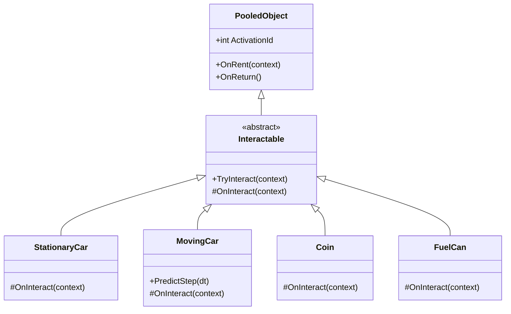
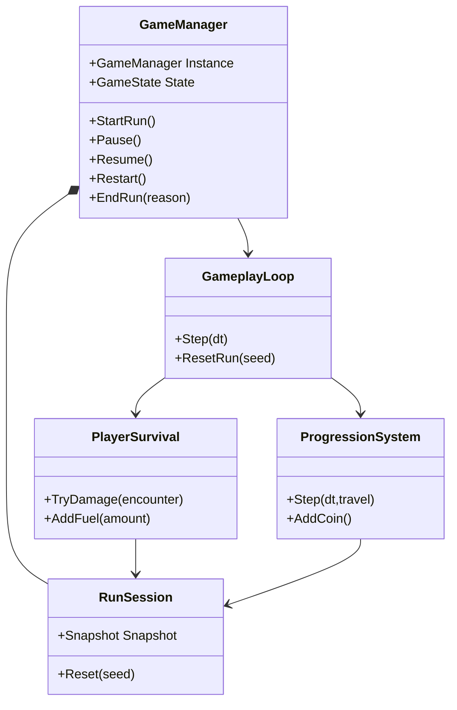
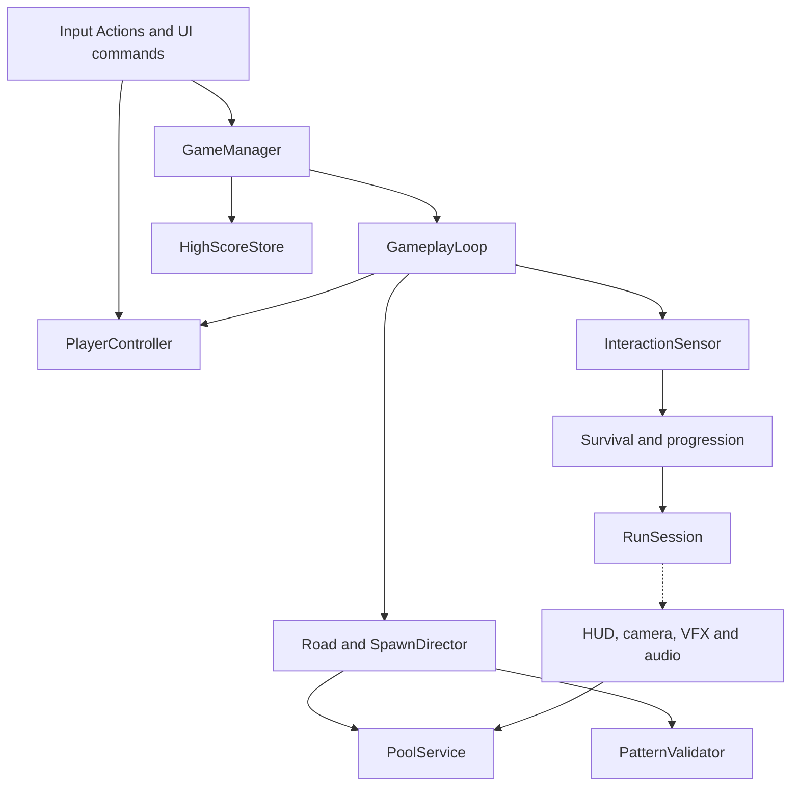
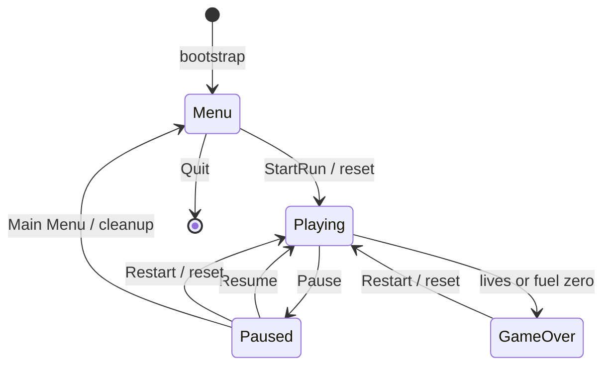
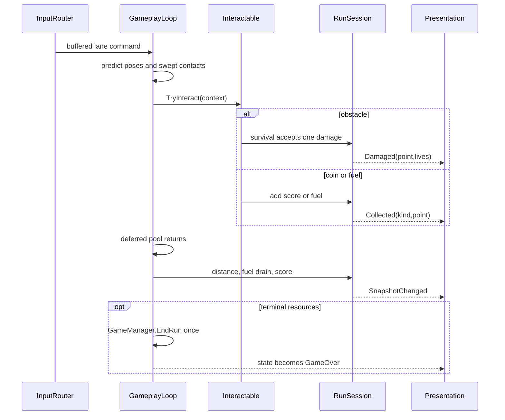

# Architecture diagrams

Mermaid source is deliberately editable. Relationships are scoped to avoid a single unreadable class graph; the complete script contracts are in document03.

## Required inheritance

`OnInteract` is virtual in the abstract base and overridden in all four children. The base guards once-per-activation handling; derived classes implement damage/reward. This is real inheritance, not an enum-only replacement.

## Core ownership

## Subsystem dependencies

Arrows mean “depends on / invokes.” The dashed presentation arrow means event subscription; presentation cannot change run values directly.

## Gameplay states

## Gameplay event flow

Five participants; presentation observes final state and typed events. Return-to-pool is deferred until contacts are dispatched so the registry stays stable.

