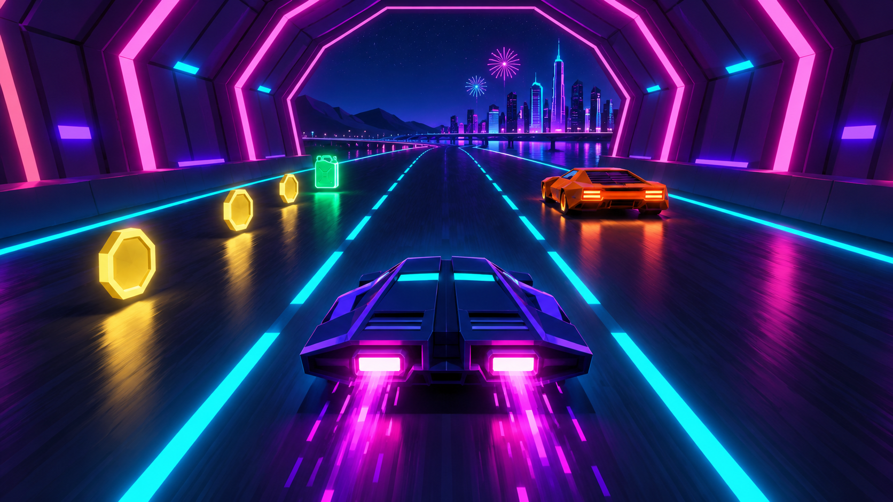
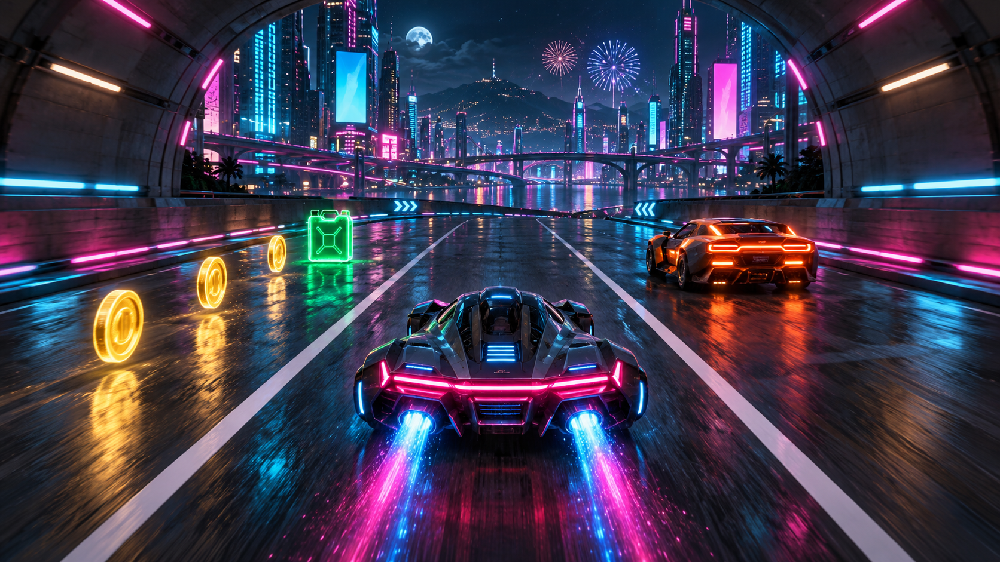
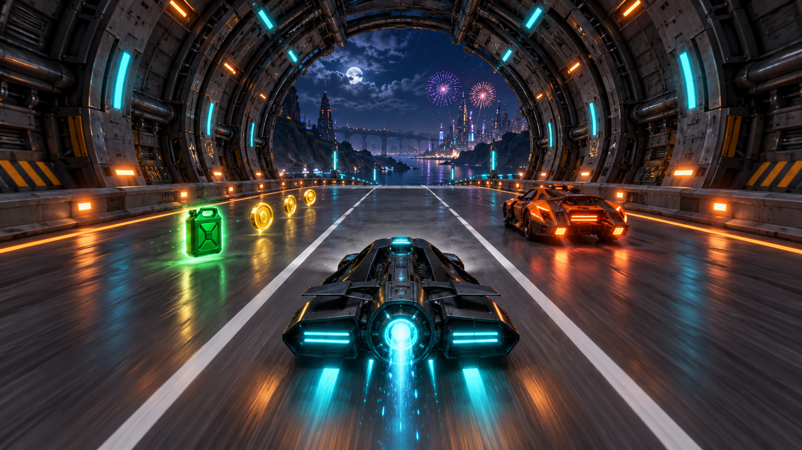

# Art direction and exploration

## Decision

Adopt **Direction A — Retro Vector Arcade with restrained modern URP light and Bloom**. It matches the user's preference, uses inexpensive reusable geometry, makes the three-lane interaction legible, and gives every assessed effect a clear purpose. The images are generated concept references, not Unity screenshots, meshes, textures with verified maps, or completed game assets.

## A — Retro Vector Arcade

Palette: ink `#070B22`, surface `#141B3F`, cyan `#35E6FF`, magenta `#FF4AC8`, violet `#8B5CFF`; shared gameplay colors gold `#FFD76A`, fuel `#69F5A9`, hazard `#FF8B4D`.

Lighting: large dark shapes with selected emissive edges; headlights provide a useful cone on road; cyan underglow scales with speed. A fixed low-exposure sky keeps fireworks bright without bleaching the roadway. Road and car must remain visible with Bloom disabled.

Vehicle: wide original wedge, faceted indigo body, split nose, narrow cyan canopy, twin rectangular magenta rear thrusters. Obstacles use chunkier orange/red silhouettes and distinct tail lamps. Road is a straight flat plane with two interior dividers; octagonal tunnel arches are built from repeated bevelled beams, and open spans use abstract skyline silhouettes. Use URP Lit for solids, simple emission strips, ParticleSystem unlit/additive materials for effects; no custom volumetric shader required.

Readability: highest of the three if architectural magenta stays dimmer than interactables. Risks are overly bright lines resembling extra lanes, oversaturated Bloom, and repeating arches becoming monotonous. Limit architecture to two main variants, alternate open sky, and use silhouette/shape differences. Relative student effort: **low–medium**, roughly 20–30 art hours after graybox for someone comfortable with Unity/Blender; an estimate, not a schedule guarantee.

## B — Cyberpunk Neon Highway

Palette: charcoal teal `#07181F`, asphalt `#14252E`, electric blue `#34BFFF`, hot pink `#FF61C7`, cool gray `#B7C9DA`; retain shared pickup/hazard colors. Lighting relies on city signs and layered atmospheric depth; keep blank sign forms, avoid actual brands. Sophisticated graphite hovercar, reflective road, large layered tunnel portals and dense towers create a cinematic mood.

Materials/VFX: URP Lit with rough reflective pavement, baked reflection probes for appearance, light rain particles only if budget permits. Screen-space reflections, dense volumetrics and dynamic mirror road are outside MVP. Readability suffers when reflections duplicate lane lines or signs compete with pickups. Best advantage is atmosphere; main risks are asset count, overdraw and lighting labor. Student feasibility: **medium with simplification**, otherwise high effort (35–55 art hours). It offers less value per hour for this assignment.

## C — Sci-Fi Industrial Tunnel

Palette: near black `#0B1118`, gunmetal `#273340`, warning orange `#FF9D3D`, cyan `#44DDE8`, pale steel `#B9CED6`; shared gold/fuel colors remain distinct. Lighting comes from repeating structural ribs and targeted work lights. Player uses black faceted panels and cyan energy details; parked service vehicles are boxy, moving traffic lower. The road remains conventional and flat beneath enormous steel arches, with deliberate open-sky breaks.

Materials/VFX: simple metallic URP Lit with one shared trim atlas; orange caution panels, thin cyan light bars, sparse steam only outside lane decisions. Industrial detail can be modular, but tunnels risk concealing the required sky/fireworks and warm warnings can look like coins. Readability is good with restrained warning colors. Student feasibility: **medium**, roughly 25–40 art hours; modeling repeats well but material variation and clutter need discipline.

## Comparison

| Criterion | A: Retro Vector | B: Cyberpunk | C: Industrial |
| --- | --- | --- | --- |
| Three-lane clarity | Excellent with controlled glow | Reflection/signage risk | Good, clutter risk |
| Cheap modular geometry | Excellent | Moderate | Good |
| Night/fireworks visibility | Natural in open spans | Strong city skyline | Requires deliberate sky breaks |
| Underglow/Bloom fit | Central to identity | Natural | Works as accent |
| Texture dependence | Low | High | Moderate |
| Student production risk | Lowest | Highest | Moderate |
| Recommendation | **Produce this** | Mood reference only | Borrow structural repetition sparingly |

## Selected direction reference set

| Reference | Image |
| --- | --- |
| Main gameplay composition | [selected-gameplay.png](../art/concepts/selected-gameplay.png) |
| Four-view player sheet | [player-design-sheet.png](../art/concepts/player-design-sheet.png) |
| Tunnel/open-road moodboard | [environment-moodboard.png](../art/concepts/environment-moodboard.png) |
| Stationary/moving obstacles | [obstacle-designs.png](../art/concepts/obstacle-designs.png) |
| Coin and fuel designs | [pickup-designs.png](../art/concepts/pickup-designs.png) |
| Main menu | [main-menu.png](../art/ui-concepts/main-menu.png) |
| Five-field live HUD | [hud-mockup.png](../art/ui-concepts/hud-mockup.png) |
| Game Over | [game-over.png](../art/ui-concepts/game-over.png) |
| Four required effects | [vfx-reference-sheet.png](../art/concepts/vfx-reference-sheet.png) |

The supplied wide images use the generator's native near-16:9 raster size. They are visual targets, not measured blueprints: apparent perspective, reflective floors and UI illustration proportions are not technical requirements. Build a straight road even where an exploratory horizon suggests a bend. Use the pickup sheet's ring silhouette as canonical; gameplay concepts may illustrate solid coin faces. Reconcile all vehicle views in modeling before treating them as orthographic production drawings. Final menus must use real text and controls, never a flattened screenshot as interactive UI.

See [visual system](../art/style-guides/visual-system.md) and [asset plan](07-asset-production-plan.md) for production constraints that override incidental generated details.
